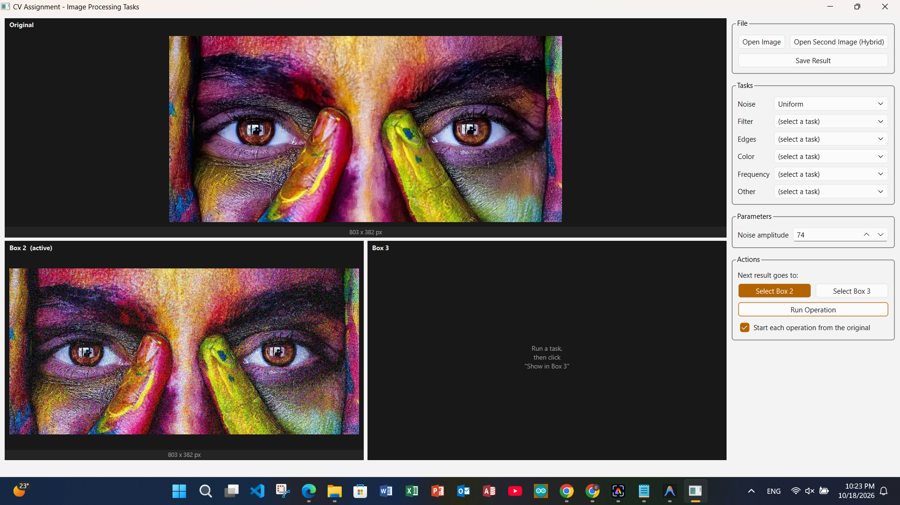
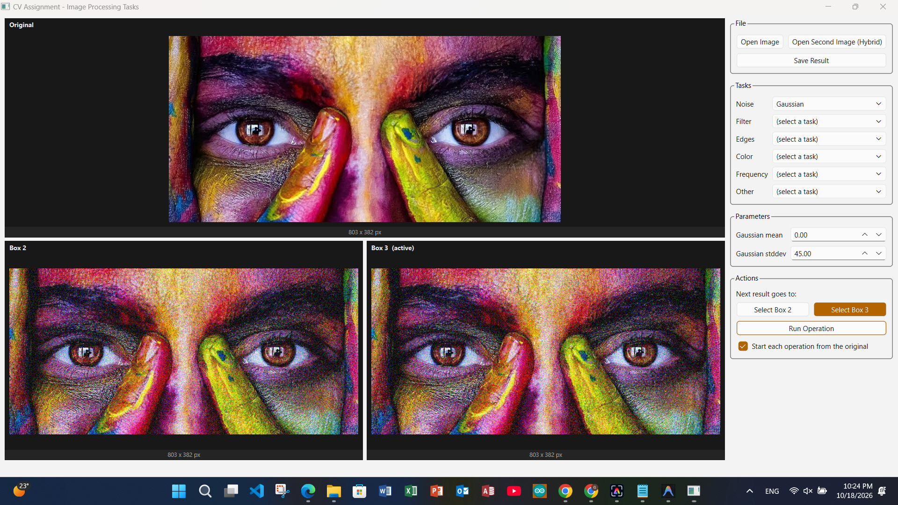
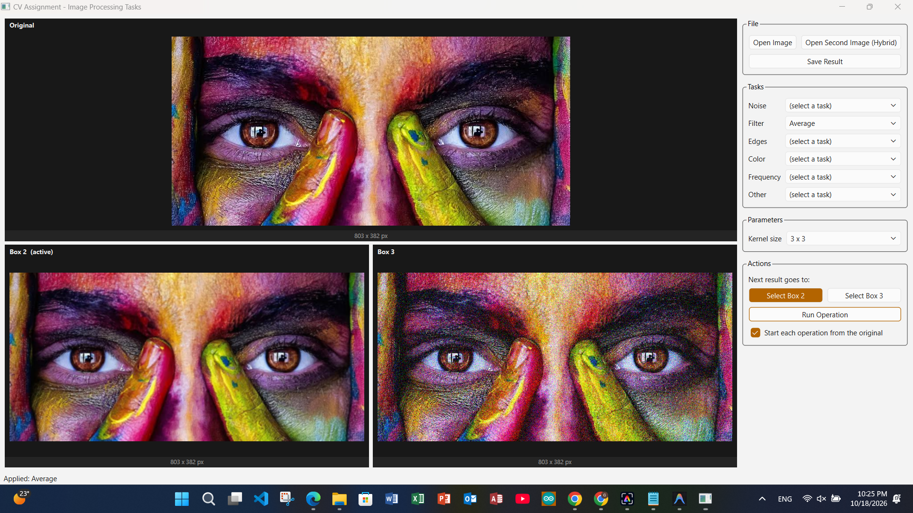
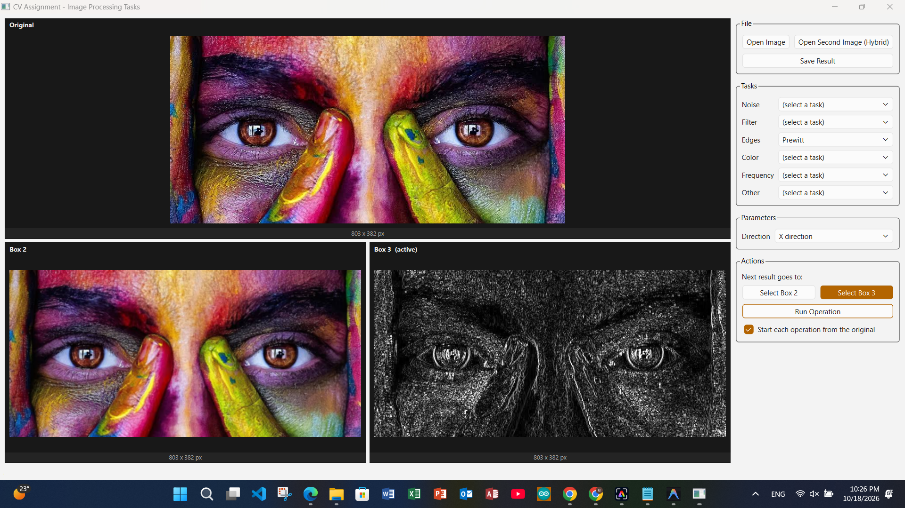
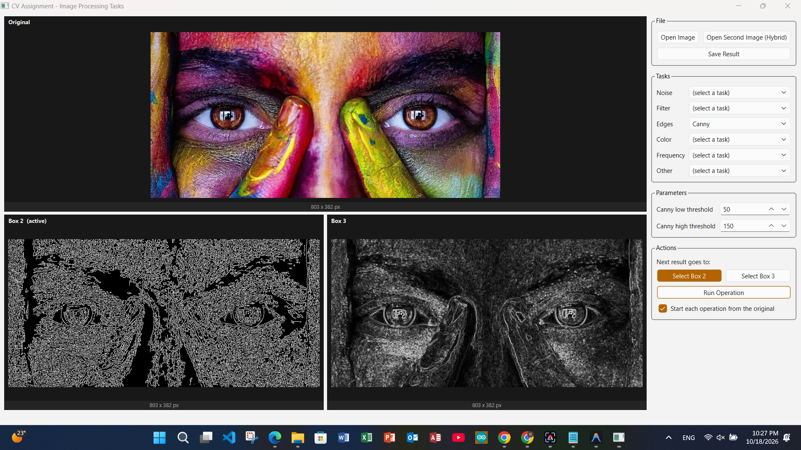
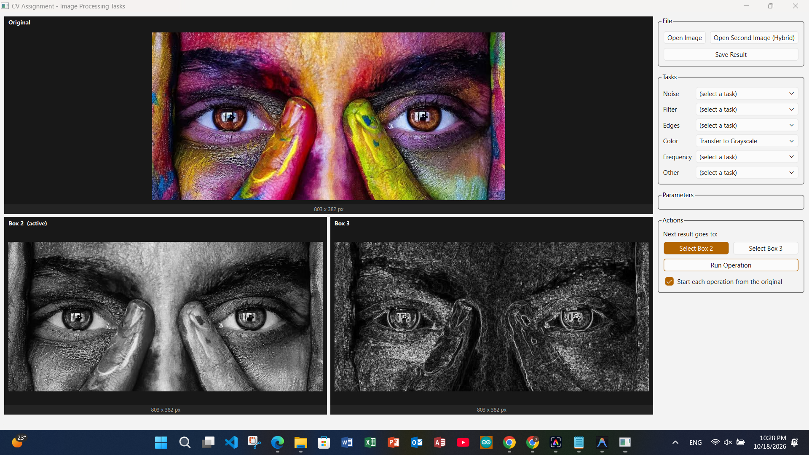
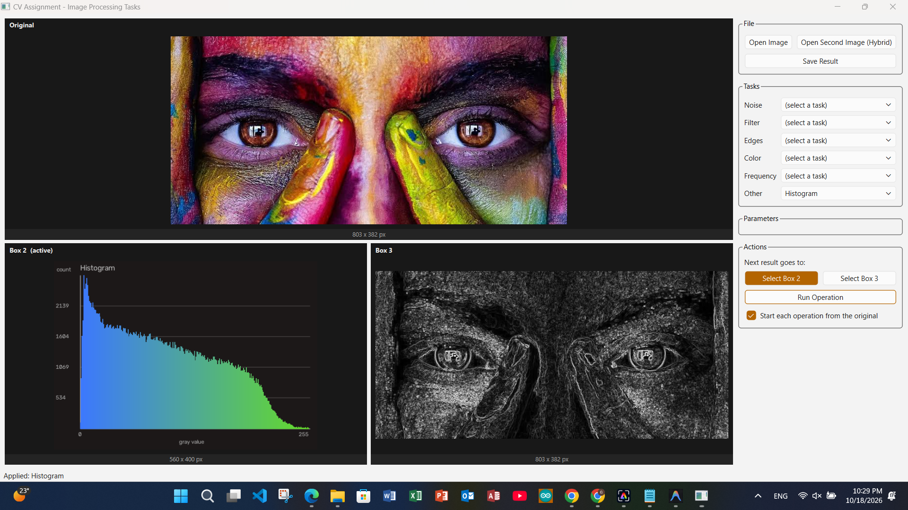
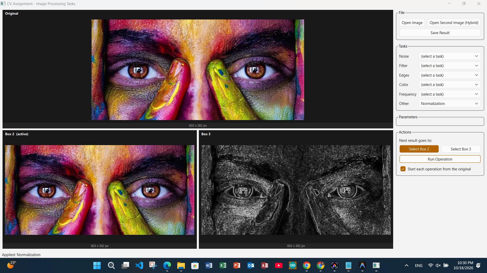
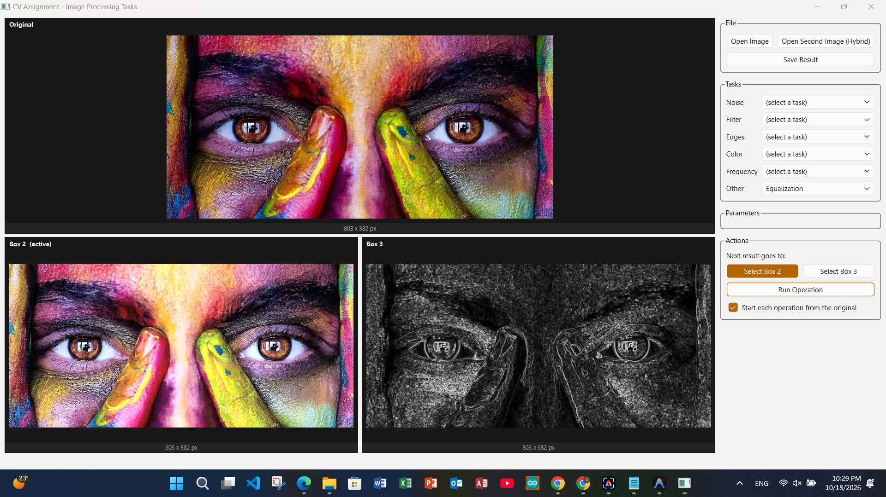
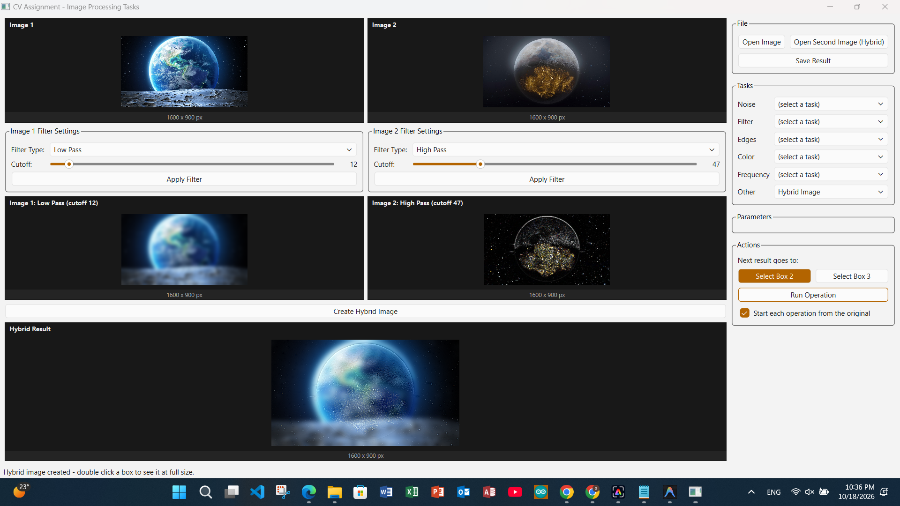

# CV Assignment – Image Processing Application

A desktop image-processing application built with **C++17**, **Qt 6 (Widgets)** and **OpenCV**.
It provides a modular GUI where the user opens an image, picks an operation from a set of
task dropdowns, adjusts the parameters that appear for that task, and views the result
next to the original. The project also ships with an IEEE-style report that documents every
UI feature (see [Report](#report)).

> **Course:** Computer Vision – Image Processing Tasks
> **Team 5** – Systems and Biomedical Engineering, Cairo University, Giza, Egypt

**Authors:** Ganna Ahmed Gomaa, Nada Mostafa, Anas Mohamed, Kareem Fareed

---

## Table of Contents

1. [Features](#features)
2. [Screenshots](#screenshots)
3. [Project Structure](#project-structure)
4. [Requirements](#requirements)
5. [Build & Run](#build--run)
6. [How to Use](#how-to-use)
7. [Hybrid Image Module](#hybrid-image-module)
8. [Report](#report)
9. [License](#license)

---

## Features

The right-hand control panel groups every operation into a dropdown:

| Group         | Operations                                                          | Parameters shown                                   |
|---------------|---------------------------------------------------------------------|----------------------------------------------------|
| **Noise**     | Uniform, Gaussian, Salt & Pepper                                    | Noise amplitude, Gaussian mean / stddev, probability |
| **Filter**    | Average, Gaussian, Median                                           | Kernel size (3×3 – 9×9), Gaussian sigma            |
| **Edges**     | Sobel, Roberts, Prewitt, Canny                                      | Direction (X / Y / X,Y), Canny low & high thresholds |
| **Color**     | Transfer to Grayscale, Channel Histograms, Channel CDF              | –                                                  |
| **Frequency** | Low Pass, High Pass                                                 | Cutoff radius                                      |
| **Other**     | Histogram, CDF Curve, Equalization, Normalization, Thresholding, Hybrid Image | Threshold value, maximum value               |

Other UI features:

- **Three display boxes** – *Original*, *Box 2* and *Box 3*. Use **Select Box 2 / Select Box 3**
  to choose where the next result is shown, so two results can be compared side by side.
- **Chain or reset** – the *"Start each operation from the original"* checkbox switches between
  independent operations and chaining each operation onto the previous result.
- **File actions** – *Open Image*, *Open Second Image (Hybrid)* and *Save Result*
  (PNG / JPEG / BMP).
- **Dynamic parameter panel** – only the parameters relevant to the selected task are used.
- **Input validation** – invalid parameter values and missing selections are reported in the
  status bar.
- **Hybrid Image mode** – switches the window to a dual-image layout (see
  [below](#hybrid-image-module)).

---

## Screenshots

> These are the same figures as in the report. Copy `fig1` … `fig13` into `docs/images/`
> keeping the report's file names (change the extension below if yours are `.jpg`).
> Captions match the report's figure captions.

### Noise

| Uniform noise | Gaussian noise (σ = 45) |
|:---:|:---:|
|  |  |

### Spatial filtering

| Average filter (3×3) | Gaussian filter (3×3, σ = 1.0) |
|:---:|:---:|
|  |  |

### Edge detection

| Prewitt – X | Prewitt – X and Y |
|:---:|:---:|
|  |  |

| Canny (low 50, high 150) | Canny (low 96) |
|:---:|:---:|
|  |  |

### Color and normalization

| Grayscale | Normalization | Normalization in Box 2 |
|:---:|:---:|:---:|
|  |  |  |

### Hybrid image

| Hybrid layout and result | Low-pass / high-pass cutoffs |
|:---:|:---:|
|  |  |

---

## Project Structure

```
Image_Processing_Projects/
├── README.md
├── LICENSE
├── docs/
│   └── images/                 # screenshots used in this README and the report
└── Task 1/
    ├── CMakeLists.txt
    ├── include/                # headers
    │   ├── backend/            # ImageProcessorController
    │   ├── services/           # one service per task + TaskTypes.h
    │   ├── ui/                 # MainWindow, HybridPanel, ImageDisplayWidget
    │   ├── utils/              # QtCvBridge (cv::Mat <-> QImage)
    │   └── validation/         # InputValidator
    └── src/                    # implementations (same layout as include/)
```

The code is layered so the GUI never calls an algorithm directly:

```
MainWindow / HybridPanel  ->  ImageProcessorController  ->  Task services (Task0 … Task10)
```

| Service | Responsibility |
|---|---|
| `Task0_ImageIOService` | Load / save images |
| `Task1_NoiseService` | Uniform, Gaussian, Salt & Pepper noise |
| `Task2_LowPassFilterService` | Average, Gaussian, Median filters |
| `Task3_EdgeDetectionService` | Sobel, Roberts, Prewitt (hand-written convolution, X / Y / both) and Canny |
| `Task4_HistogramService` | Histogram and CDF |
| `Task5_EqualizationService` | Histogram equalization |
| `Task6_NormalizationService` | Image normalization |
| `Task7_ThresholdingService` | Thresholding |
| `Task8_ColorTransformationService` | Grayscale, per-channel histograms and CDFs |
| `Task9_FrequencyFilterService` | Frequency-domain low-pass / high-pass |
| `Task10_HybridImageService` | Hybrid image generation |

---

## Requirements

- A C++17 compiler (GCC / Clang / MSVC)
- **CMake ≥ 3.16**
- **Qt 6** with the *Widgets* module
- **OpenCV** (found through `find_package(OpenCV REQUIRED)`)
- Ninja or Make (any CMake generator works)

The project was developed on Windows with **MSYS2 UCRT64** (GCC, Qt 6, OpenCV, Ninja).

### Installing dependencies

**Windows (MSYS2 UCRT64 shell)**

```bash
pacman -S mingw-w64-ucrt-x86_64-toolchain \
          mingw-w64-ucrt-x86_64-cmake \
          mingw-w64-ucrt-x86_64-ninja \
          mingw-w64-ucrt-x86_64-qt6-base \
          mingw-w64-ucrt-x86_64-opencv
```

**Ubuntu / Debian**

```bash
sudo apt install build-essential cmake ninja-build qt6-base-dev libopencv-dev
```

**macOS (Homebrew)**

```bash
brew install cmake ninja qt opencv
```

---

## Build & Run

```bash
git clone <repository-url>
cd Image_Processing_Projects/"Task 1"

cmake -S . -B build -G Ninja
cmake --build build
```

If CMake cannot find Qt or OpenCV, point it at them:

```bash
cmake -S . -B build -G Ninja \
      -DCMAKE_PREFIX_PATH="/path/to/Qt/6.x/gcc_64" \
      -DOpenCV_DIR="/path/to/opencv/lib/cmake/opencv4"
```

Run the executable:

```bash
./build/CV_Assignment          # Linux / macOS
build\CV_Assignment.exe        # Windows
```

You can also open `Task 1/CMakeLists.txt` directly in **Qt Creator** or **CLion** and press *Run*.

> On Windows, run the app from the MSYS2 UCRT64 shell (or add `ucrt64/bin` to `PATH`) so the Qt
> and OpenCV DLLs are found.

---

## How to Use

1. Click **Open Image** and choose a `.png`, `.jpg`, `.jpeg`, `.bmp`, `.tif` or `.tiff` file.
   It appears in the **Original** box.
2. In the **Tasks** group, choose one operation from one of the dropdowns
   (Noise, Filter, Edges, Color, Frequency, Other).
3. Set the relevant values in the **Parameters** group (kernel size, sigma, thresholds, …).
4. Choose where the result goes with **Select Box 2** or **Select Box 3**.
5. Click **Run Operation**. The result appears in the selected box.
6. Tick or untick *"Start each operation from the original"* to either restart from the original
   image or chain operations (for example: add noise, then filter it).
7. Click **Save Result** to export the result as PNG, JPEG or BMP.

**Example workflow – denoising:** Noise → *Gaussian* (stddev 45) → Box 2, then untick the
reset checkbox, Filter → *Average* (3×3) → Box 3, and compare the boxes.

---

## Hybrid Image Module

Selecting **Other → Hybrid Image** replaces the single-image pipeline with a dual-image layout.

1. Click **Open Image** for *Image 1* and **Open Second Image (Hybrid)** for *Image 2*.
2. In each *Image N Filter Settings* group, choose **Low Pass** or **High Pass** and set the
   **Cutoff** (slider, default 12, max 200), then click **Apply Filter**.
3. Click **Create Hybrid Image** to combine the two filtered images into the *Hybrid Result*.
4. Double-click any box to view it at full size.

Tip: apply **Low Pass** to one image and **High Pass** to the other. The result looks like the
high-pass image up close and like the low-pass image from a distance.

---

## Report

The accompanying report (`report.tex`, IEEEtran conference format) documents the GUI and every
supported operation, with a screenshot for each feature.

**Build the PDF**

```bash
# figures fig1 … fig13 must be in the same folder as report.tex
pdflatex report.tex
pdflatex report.tex     # run twice to resolve references
```

Or upload `report.tex` and the figure files to [Overleaf](https://www.overleaf.com).

Report sections: Introduction · Noise Addition · Spatial Filtering · Edge Detection ·
Histogram Operations · Color Space Transformations · Normalization · Hybrid Image Generation ·
Conclusion.

---

## License

See the [LICENSE](LICENSE) file.