# Computer Vision & Image Processing Studio

A modular, dynamic desktop application designed for applying fundamental and advanced computer vision algorithms. The tool provides real-time parameter tuning, multi-view visual comparisons, and a dedicated workspace for creating hybrid images.

---

## 👥 Authors (Team 5)
* **Ganna Ahmed Gomaa**
* **Nada Mostafa**
* **Anas Mohamed**
* **Kareem Fareed**

*Systems and Biomedical Engineering Department, Cairo University, Giza, Egypt*

---

## 📌 Table of Contents
- [Overview & Architecture](#-overview--architecture)
- [Supported Features & Tasks](#-supported-features--tasks)
  - [1. Noise Addition](#1-noise-addition)
  - [2. Spatial Filtering Techniques](#2-spatial-filtering-techniques)
  - [3. Edge Detection Algorithms](#3-edge-detection-algorithms)
  - [4. Histogram Operations](#4-histogram-operations)
  - [5. Color Space Transformations](#5-color-space-transformations)
  - [6. Normalization](#6-normalization)
  - [7. Hybrid Image Generation Module](#7-hybrid-image-generation-module)
- [Project Structure & Assets](#-project-structure--assets)

---

## 🖥 Overview & Architecture

The application features an adaptive graphical user interface (GUI) divided into two main sections:
1. **Visual Display Panels (Left):** Multiple viewport boxes (Box 1, Box 2, Box 3) allowing side-by-side comparison between the original input and processed outputs.
2. **Control Panel (Right):** A task-driven sidebar where parameter controls dynamically update based on the selected algorithm category.

---

## 🚀 Supported Features & Tasks

### 1. Noise Addition
Used to simulate sensor artifacts and evaluate filter robustness.

* **Uniform Noise:**
  * *Parameters:* `Noise amplitude` (e.g., set to 74).
  * Output rendered to **Box 2**.

  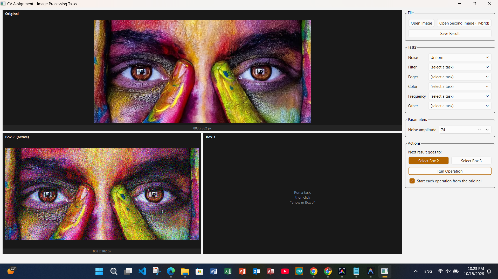  
  *Fig. 1: Uniform Noise applied to the image.*

* **Gaussian Noise:**
  * *Parameters:* `Gaussian mean` (e.g., `0.00`) and `Gaussian stddev` (e.g., `45.00`).
  * Output directed to **Box 3** for direct side-by-side comparison with Box 2.

    
  *Fig. 2: Gaussian Noise applied with a standard deviation of 45.00.*

* **Salt & Pepper Noise:**
  * *Parameters:* `Noise probability` (e.g., `0.200`).
  * Replaces corrupted pixels with pure black or pure white values. Compatible with color and grayscale images.

  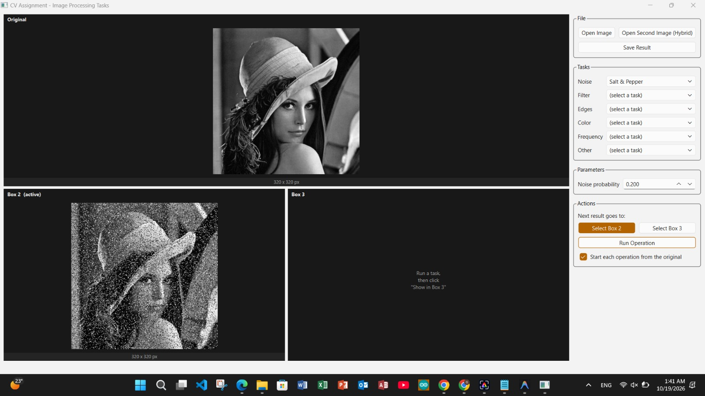  
  *Fig. 3: Salt & Pepper Noise applied with a noise probability of 0.200.*

---

### 2. Spatial Filtering Techniques
Smoothing and noise suppression operations available under the **Filter** menu:

* **Average Filter:**
  * *Parameters:* `Kernel size` (e.g., $3 \times 3$).
  * Replaces each pixel with the uniform mean of its local neighborhood.

  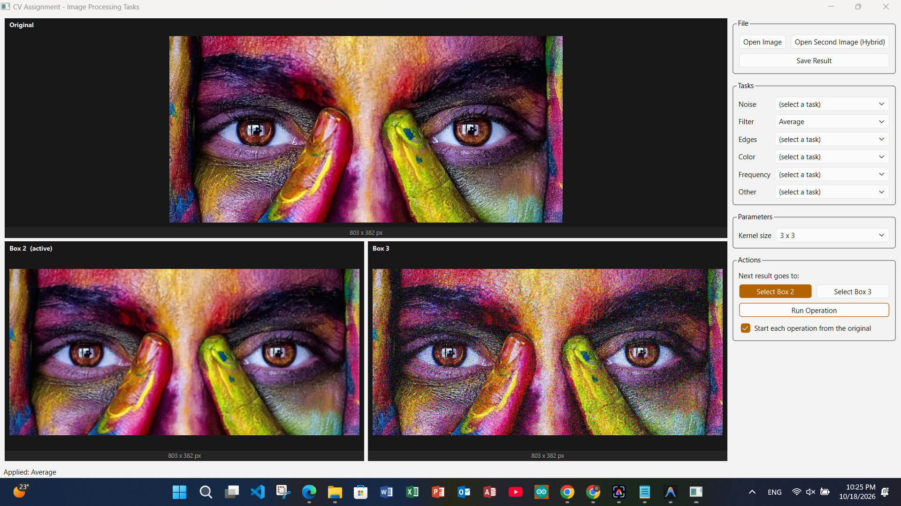  
  *Fig. 4: Average Filter applied with a 3x3 kernel.*

* **Gaussian Filter:**
  * *Parameters:* `Kernel size` (e.g., $3 \times 3$) and `Gaussian sigma` (e.g., $\sigma = 1.0$).
  * Applies a distance-weighted Gaussian distribution to preserve central pixel weight.

  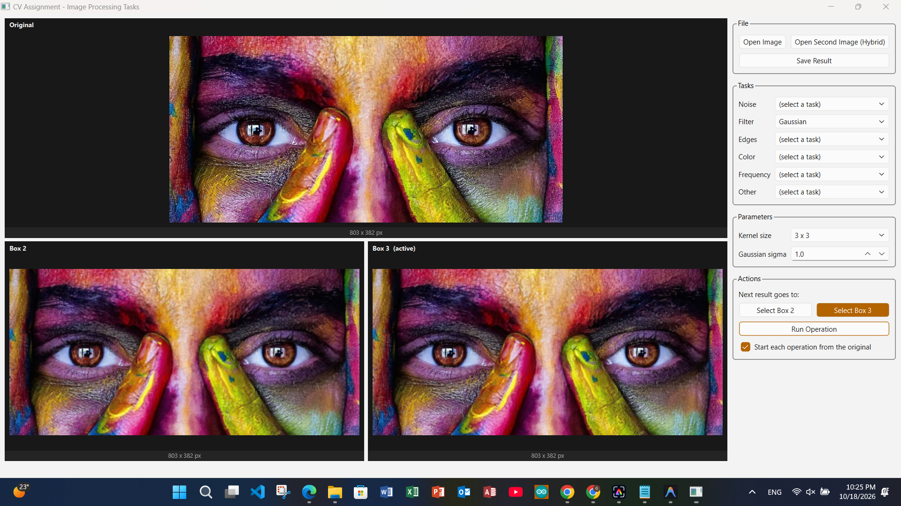  
  *Fig. 5: Gaussian Filter applied with a 3x3 kernel and sigma 1.0.*

---

### 3. Edge Detection Algorithms
Gradient and boundary detection tools accessible under the **Edges** category:

* **Prewitt Operator (X direction):**
  * *Parameters:* `Direction` set to `X direction`.
  * Computes gradient along the horizontal axis.

  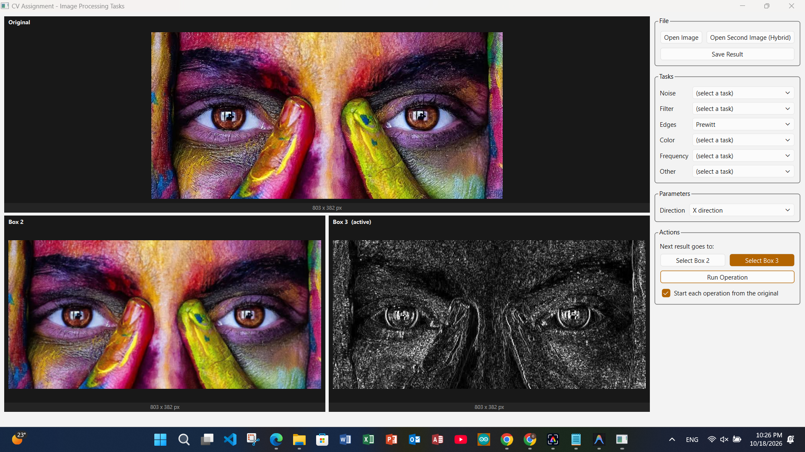  
  *Fig. 6: Prewitt Operator (X direction).*

* **Prewitt Operator (X and Y combined):**
  * *Parameters:* `Direction` set to `X,Y directions`.
  * Combines horizontal and vertical gradients into a unified edge map.

    
  *Fig. 7: Prewitt Operator (X and Y directions combined).*

* **Canny Edge Detector (Default Thresholds):**
  * *Parameters:* `Canny low threshold` = `50`, `Canny high threshold` = `150`.
  * Preserves weaker edges, yielding a dense edge map.

  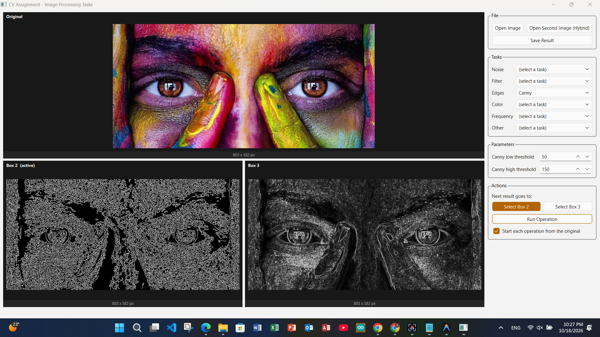  
  *Fig. 8: Canny Edge Detector with low threshold 50 and high threshold 150.*

* **Canny Edge Detector (Tuned Low Threshold):**
  * *Parameters:* `Canny low threshold` raised to `96`, `Canny high threshold` = `150`.
  * Discards weak false edges, resulting in a sparser, cleaner edge map.

    
  *Fig. 9: Canny Edge Detector with adjusted low threshold of 96.*

---

### 4. Histogram Operations
Tools for tonal analysis and contrast enhancement under the **Other** category:

* **Histogram Plotting:**
  * Computes and displays the frequency distribution of pixel intensities (0–255 on X-axis, pixel count on Y-axis) in **Box 2**.

  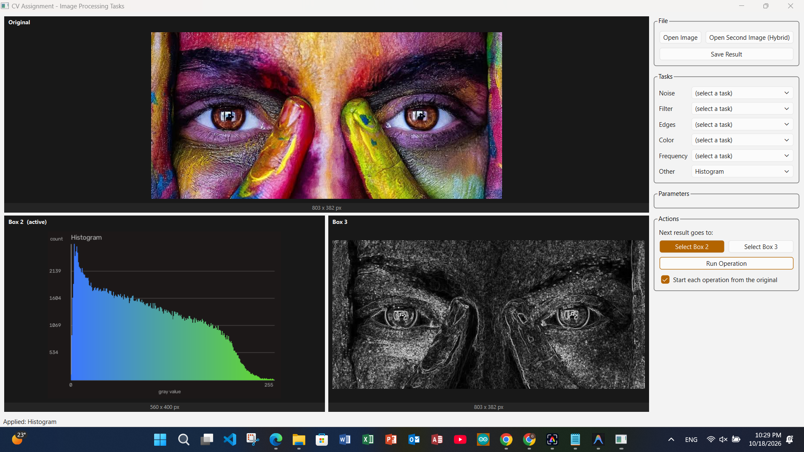  
  *Fig. 10: Histogram of the image gray values.*

* **Histogram Equalization:**
  * Re-distributes pixel intensities across the spectrum to enhance global image contrast.

  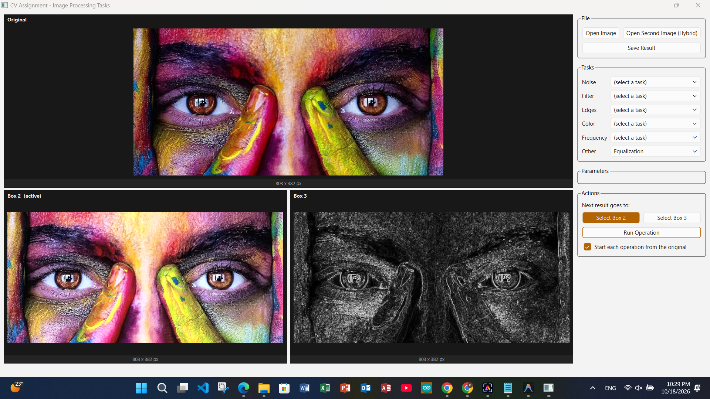  
  *Fig. 11: Histogram Equalization applied to the image.*

---

### 5. Color Space Transformations
Accessible under the **Color** task dropdown:

* **Transfer to Grayscale:**
  * Converts multi-channel RGB/color images into a single-channel grayscale image without requiring parameters.

  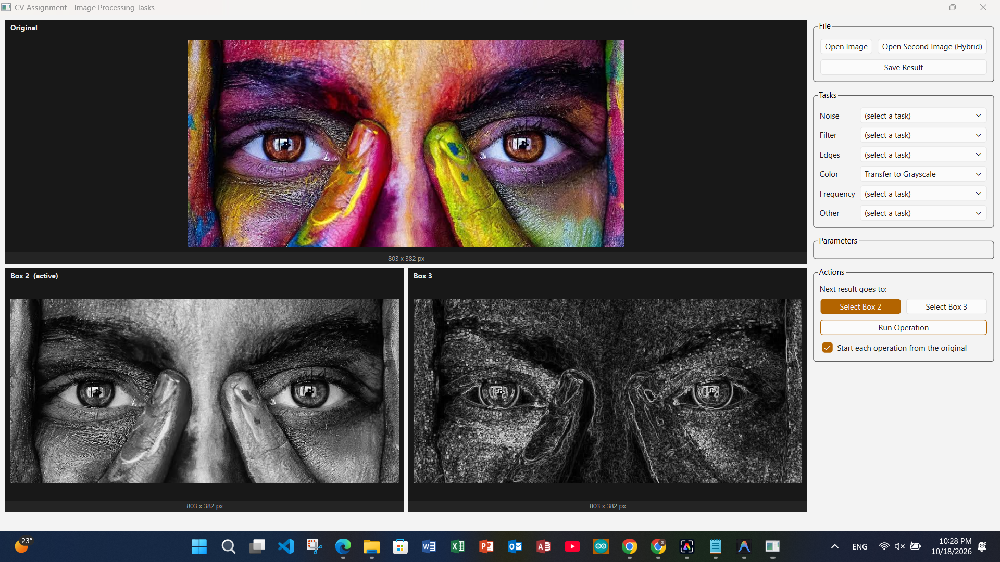  
  *Fig. 12: Transfer to Grayscale operation.*

---

### 6. Normalization
Accessible under the **Other** category:

* **Image Normalization:**
  * Rescales pixel intensity dynamic ranges across the entire image. The status bar confirms: `Applied: Normalization`.

  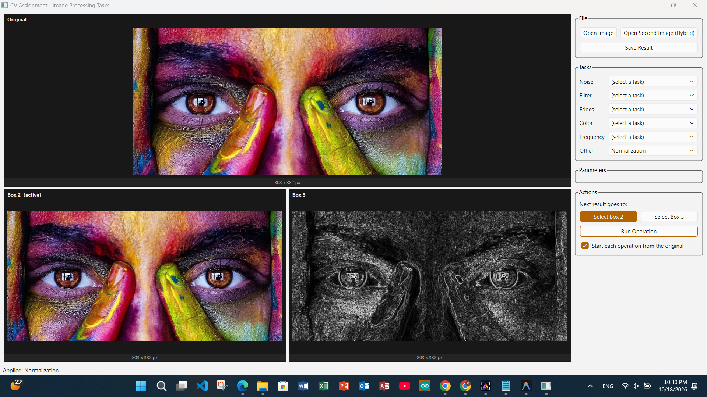  
  *Fig. 13: Image Normalization applied, with the result mapped to Box 2.*

---

### 7. Hybrid Image Generation Module
Selecting **"Hybrid Image"** dynamically switches the UI from a single-image pipeline to a dedicated **dual-image processing framework**:

* **Dual Input Panels:** Loads two separate source images (Image 1 and Image 2).
* **Independent Frequency Controls:**
  * **Low-Pass Filter:** Slider to adjust the cutoff frequency on Image 1 (e.g., cutoff = `12`).
  * **High-Pass Filter:** Slider to adjust the cutoff frequency on Image 2 (e.g., cutoff = `47`).
* **Visual Verification:** Displays low-pass and high-pass results in intermediate panels before combining.
* **Hybrid Synthesis:** Merges low-frequency spatial structure with high-frequency details into a final composite via `Create Hybrid Image`.

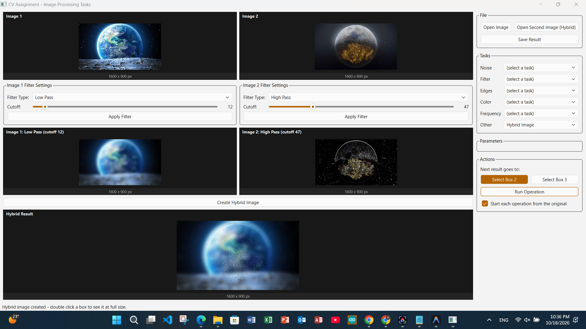  
*Fig. 14: Hybrid Image generation layout showing the Low Pass and High Pass cutoffs and the final result.*

---

## 📜 License
Developed for academic purposes under the **Systems & Biomedical Engineering Department, Cairo University**.